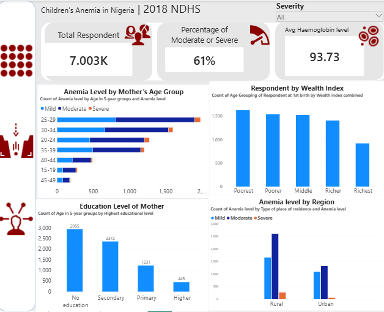

# Children's Anaemia in Nigeria | Power BI

A Power BI dashboard showing which children are most affected by anaemia in Nigeria and where prevention can reach them, using the 2018 Nigeria Demographic and Health Survey (NDHS).

## Project Overview
33,924 survey records were cleaned in Excel. Mother-only columns and children without anaemia were removed, leaving 7,003 children with mild, moderate or severe anaemia. Power BI was used to build the charts.

## Project Objectives
- Show which children are most affected by anaemia.
- Compare cases by wealth, mother's education, mother's age and place of residence.
- Look at iron supplement use.
- Suggest where prevention programs should focus.

## Tools Used
- Microsoft Excel (data cleaning)
- Microsoft Power BI (dashboard)
- Data visualisation and KPI reporting

## Dashboard Preview

## Key Insights
- **Severity:** Moderate 3,927 (56%), mild 2,754 (39%), severe 322 (5%). More than 6 in 10 cases are moderate or severe (61%).
- **Hemoglobin:** the average is 93.73, falling from 104.6 in mild cases to 60.5 in severe cases.
- **Mother's age:** cases peak when the mother is aged 25 to 34 (about 51%). Only 4% are aged 15 to 19.
- **Wealth:** the poorest group has the most cases (1,624) and the richest the fewest (917).
- **Mother's education:** 2,955 (42%) have no formal education.
- **Residence:** rural homes account for 4,534 cases (65%) and hold 266 of the 322 severe cases.
- **First birth:** 57% of mothers first gave birth between ages 12 and 19.
- **Iron supplements:** 80.37% reported No and 19.29% Yes. Use rises with wealth, from 10.6% in the poorest group to 30.1% in the richest.

## Recommendations
1. Target rural and low-income households with community-based programs.
2. Make iron supplements easier to get and explain them better, especially in the poorest households.
3. Reach mothers in their 20s and early 30s with nutrition and child health education.
4. Use simple, spoken messages such as radio and community meetings.
5. Strengthen early screening in rural health centres, where 83% of severe cases are found.

## Limitations
The data covers children with anaemia only, so the findings show who the cases are, not which groups have higher rates. The survey has no child age, so age and education describe the mother.

## Project Files
- `Children_Anaemia_Dashboard%202.png` — The Pattern page of the dashboard.
- `Children_Anaemia_Dashboard 2.png` — The Gap page of the dashboard.
- `Children_Anaemia_Presentation.pptx` — presentation of the findings.

## Data Source
Practice dataset from my IHIFIX data analysis course, based on a Nigeria Demographic and Health Survey (DHS Program, https://dhsprogram.com). The data files are not included in this repository.

## Conclusion
Anaemia is not linked to one factor. The most cases are in rural, low-income homes with low iron use and mothers with little schooling. A combined approach of iron access, community health workers and simple communication is needed.

## Author
Orherime Betty Ejakpovi — Data Analyst | Excel · SQL · Power BI

[LinkedIn](https://www.linkedin.com/in/orherime-ejakpovi) · [Portfolio](https://betsej.github.io/)
